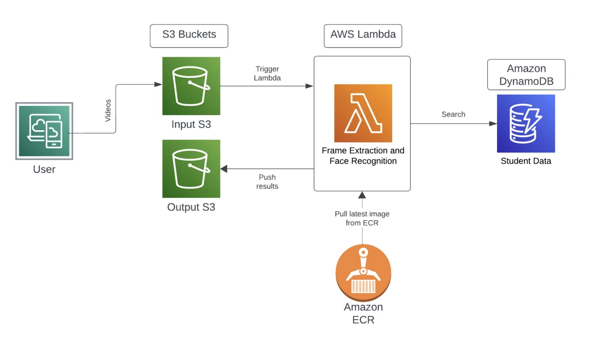

# Student Recognition from Classroom Videos

A video-processing service that identifies known students in uploaded classroom videos and saves the results as CSV files. The application extracts video frames, compares detected faces with stored face encodings, retrieves student information from DynamoDB, and writes the results to Amazon S3.

The project explores two ways to run the processing pipeline: an AWS Lambda deployment and an OpenFaaS deployment connected to AWS storage and database services.

**Technologies:** Python, AWS Lambda, Amazon S3, Amazon DynamoDB, Amazon ECR, Docker, OpenFaaS, Kubernetes, FFmpeg, `face_recognition`

## AWS architecture

## Processing flow

1. A video is uploaded to the input S3 bucket
2. The processing function extracts frames using FFmpeg
3. The recognition library compares faces with the available reference encodings
4. The handler queries DynamoDB for the matching student information
5. A CSV result is generated and uploaded to the output S3 bucket

The application uses an existing face-recognition library and reference encodings; the work centers on the processing handler, database lookup, result generation, and service integration.

## Deployment variants

| Variant | Processing | Supporting services |
| --- | --- | --- |
| AWS | Container-based Lambda function, with the image stored in ECR | S3 input/output buckets and DynamoDB |
| OpenFaaS | Python function deployed through OpenFaaS on a local Kubernetes environment | S3 input/output buckets and DynamoDB |

In the AWS version, an S3 upload event triggers Lambda. The OpenFaaS version uses an event-listener component to invoke processing for uploaded videos.

## Implementation materials

The AWS implementation includes `handler.py`, a `Dockerfile`, and scripts for workload submission and testing. The OpenFaaS implementation includes `functions.yml`, `face_recognition/handler.py`, a dependency file, and test videos.

The handlers connect video processing to database queries and CSV output. The workload scripts and reports document tests involving concurrent video uploads, including a workload of 100 simultaneous uploads, and checks of the generated results.

## Setup requirements

Running the application requires:

- Separate S3 buckets for input videos and output results
- A DynamoDB table containing the student records expected by the handler
- Reference face encodings that match those records
- FFmpeg and the Python dependencies used by the selected handler
- An ECR image and Lambda configuration, or an OpenFaaS/Kubernetes environment
- AWS authentication and permissions for the required S3 and DynamoDB operations

Configure bucket names, table names, image locations, and authentication for your own environment. For Lambda, use an execution role for AWS access. Keep credentials and private student information out of the repository.

The archived AWS Dockerfile references `requirements.txt` and `entry.sh`, which are absent from that archive. Those files and the deployment configuration must be restored before the container can be rebuilt. This repository documents the implementation and architecture; it is not a complete one-command deployment package.

## Evaluation scope

The available material documents functional tests and concurrent upload workloads. It does not establish recognition accuracy on a representative classroom dataset or demonstrate suitability for attendance decisions.

## Related work

[Project background and other work](https://sidharth-dinesh.github.io/) · [GitHub profile](https://github.com/Sidharth-Dinesh)
